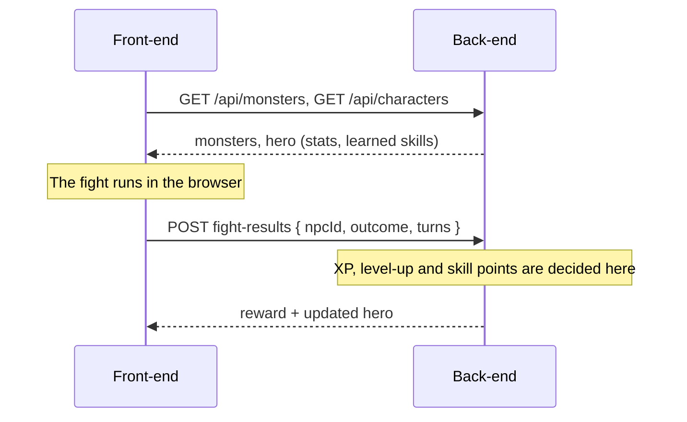

# Keldrith

A turn-based browser RPG. Register, create a hero, learn skills, fight monsters and level up.

Keldrith is a full-stack project by [Niko](https://github.com/MonkeyDNaara) (front-end) and [Kevin](https://github.com/Sazzle-Kevin) (back-end), built as the hand-in project of the WBS Coding School software engineering course.

## Features

- Register and log in (JWT)
- Create, rename and delete a hero: four classes (Warrior, Ranger, Monk, Priest), one hero per account
- Turn-based fights against monsters: attack, defend, class skills, flee
- XP and level-ups, decided by the server
- Learn skills with skill points; learned skills show up in the next fight
- Light and dark theme, responsive layout

## Tech stack

| Part      | Technology                                                                                                      |
| --------- | --------------------------------------------------------------------------------------------------------------- |
| Front-end | React 19, TypeScript, Vite, Tailwind CSS + daisyUI, TanStack Query, React Router, react-hook-form + zod, Vitest |
| Back-end  | ASP.NET Core 10 Minimal API, Entity Framework Core, SQLite, JWT authentication, Scalar API docs                 |

## How it works

The back-end owns all game data and every reward. The front-end plays the fight and reports only the outcome:



Stats, XP curve and learn-skill rules are computed on the server. The client never sends XP. Details and all endpoints are in the [back-end README](back-end/Keldrith.Auth.Api/README.md), the fight engine and screens are described in the [front-end README](front-end/README.md).

## Project structure

| Folder       | Content                                | Details                                                                      |
| ------------ | -------------------------------------- | ---------------------------------------------------------------------------- |
| `front-end/` | React app, fight engine, API client    | [front-end/README.md](front-end/README.md)                                   |
| `back-end/`  | ASP.NET Core Web API, SQLite, JWT auth | [back-end/Keldrith.Auth.Api/README.md](back-end/Keldrith.Auth.Api/README.md) |

## Run it locally

Requirements: Node.js (see `front-end/.nvmrc`) and the .NET 10 SDK.

**1. Start the back-end** (http://localhost:5080)

```bash
cd back-end/Keldrith.Auth.Api
dotnet tool restore
dotnet run
```

On first start the database is created, migrated and seeded (classes, skills, monsters and the demo account). In development, the API documentation is available at http://localhost:5080/scalar.

**2. Point the front-end at the real back-end**

Create `front-end/.env.local` (git-ignored):

```bash
VITE_USE_MOCKS=false
```

**3. Start the front-end** (http://localhost:5173)

```bash
cd front-end
npm install
npm run dev
```

Without `.env.local` the front-end uses a mock API in the browser, so it also runs without the back-end.

### Demo account (development only)

| Email               | Password        |
| ------------------- | --------------- |
| `demo@keldrith.dev` | `demo-password` |

The account has one hero (Aldric, Warrior, level 3). It is only created when the back-end runs in the `Development` environment.

### Reset the database

Stop the back-end, delete the database files, start it again:

```bash
cd back-end/Keldrith.Auth.Api
rm keldrith-auth.db*
dotnet run
```

All accounts and heroes are gone; the demo account is seeded again.

## Checks

```bash
cd front-end
npm run check   # lint, format check, tests, build
```

## Status and known limits

The course scope (accounts, hero, fights, XP, skills) is complete. Not built yet: an admin page.

- The fight runs in the browser and the server trusts the reported outcome. Moving the fight to the server is planned before anything with real value is added.
- Two parallel learn-skill requests can double-spend skill points (documented in the back-end README).
- Leaving a running fight ends it without sending a result.

## License

No license has been chosen yet. Until one is added, all rights are reserved.
